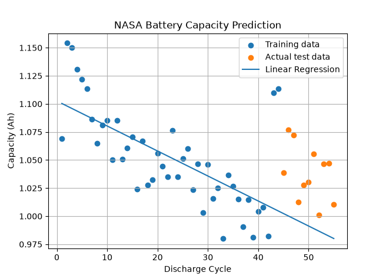

 
NASA Battery Capacity Prediction
Python | Machine Learning | Lithium-ion Batteries | Regression
Project Overview
This exploratory project uses NASA's B0053 lithium-ion battery discharge data to investigate how battery capacity changes over repeated discharge cycles and to predict future capacity using linear regression.
The goal is to practice real engineering data analysis: loading experimental measurements, preparing a dataset, examining the degradation trend, training a model, and evaluating its predictions on later cycles.
Scope: This is a small educational experiment, not a production-ready battery health or remaining-useful-life estimator.

Dataset
- Source: NASA lithium-ion battery aging dataset, cell B0053 (MATLAB .mat format).
- Observation: one discharge-cycle record per row in the processed analysis.
- Prediction target: measured discharge capacity in ampere-hours (Ah).
- Available discharge cycles in this analysis: 56.
- One suspicious near-zero capacity observation at cycle 56 was excluded, leaving 55 usable observations.
Note: The excluded observation should be checked against the raw recording before deciding whether it is a measurement error or a genuine end-of-life behavior.
Method
1. Load the NASA B0053 MATLAB dataset into Python.
2. Extract discharge-cycle capacity measurements and organize them for analysis.
3. Inspect the data and exclude the anomalous final near-zero capacity record for this experiment.
4. Use cycle number to model the trend in capacity with linear regression.
5. Split the observations chronologically: earlier cycles for training, later cycles for testing. This better reflects the task of forecasting future degradation than a random split.
6. Compare predicted and actual battery capacity and calculate regression error metrics.
Model Evaluation
Metric	Result
Training observations	44
Test observations	11
Test Mean Absolute Error (MAE)	0.0469 Ah
Test Root Mean Squared Error (RMSE)	0.0517 Ah

MAE summarizes the average absolute difference between predicted and measured capacity. RMSE gives larger errors more weight.
Capacity Prediction Graph
 
Figure: Battery capacity across discharge cycles, with the fitted linear trend and held-out test predictions.
The measurements show an overall decrease in capacity as cycle count increases. The fitted model captures that broad downward trend, but the later test measurements fluctuate and are generally higher than the predictions. This is an example of how a useful trend model can still have systematic prediction error on future observations.
The figure is stored as NASA_Battery_Capacity_Prediction.png in the repository root alongside README.md.
Main Findings
- Battery discharge capacity generally declines with increasing cycle count.
- A simple linear regression provides an interpretable baseline for degradation forecasting.
- Chronological train/test splitting helps measure performance on later, unseen cycles.
- The model's underprediction on the test section indicates that a straight-line trend does not capture every change in the measured capacity.
- Outlier treatment matters: the excluded final observation could strongly influence a small dataset, so it warrants separate investigation.
Technologies
- Python
- SciPy (reading MATLAB .mat data)
- Pandas / NumPy (data preparation)
- Matplotlib (visualization)
- Linear regression and regression error metrics
Limitations and Future Work
- Only one battery and a small number of usable discharge observations were studied.
- The model is a baseline trend model, not a validated battery management system.
- The anomalous final record needs investigation rather than permanent dismissal.
- Future experiments could compare additional models, evaluate multiple batteries, and test whether voltage, current, or temperature features improve prediction without introducing data leakage.
- Further testing would be needed before estimating battery state of health or remaining useful life in a real application.
